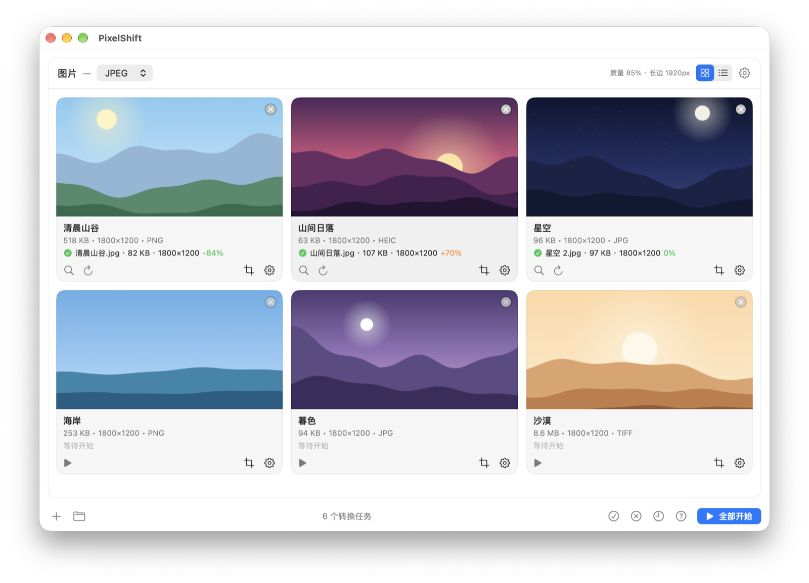
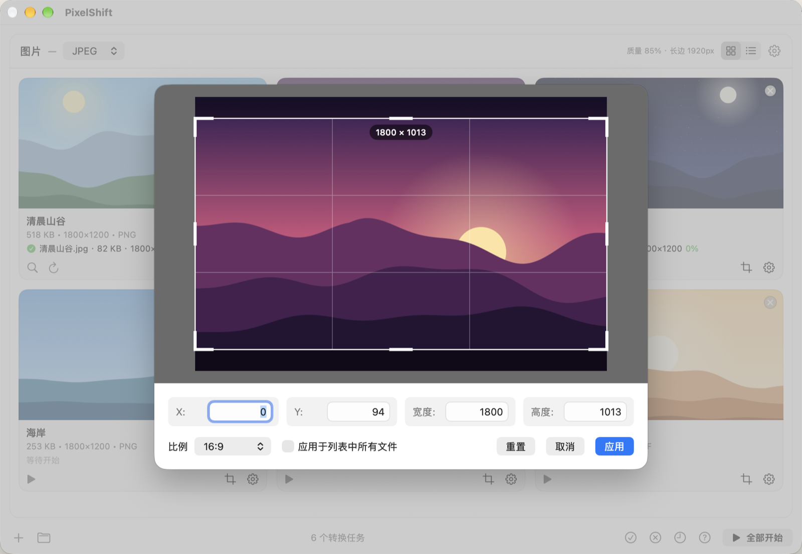

<p align="center">
  
</p>

<h1 align="center">PixelShift</h1>

<p align="center">一个轻巧的 macOS 原生图片批量转换工具：拖进来，选格式，点开始。</p>

<p align="center">
  
  
  
</p>



## 功能

- **格式互转**：HEIF / JPEG / PDF / PNG / TIFF。可以读取系统 ImageIO 支持的所有图片格式（HEIC、WebP、GIF、BMP、RAW 等）。
- **批量处理**：拖入多张图片或整个文件夹，多张同时转换。
- **调整大小**：按百分比、最长边，或指定宽 × 高，可选保持比例、不放大小图。
- **文件大小限制**：输入上限（kB）。先自动降低画质，降到最低还超出时再逐步缩小尺寸，直到不超过上限。
- **旋转 / 翻转**：顺时针或逆时针转 90°、转 180°、水平翻转、垂直翻转。照片会按 EXIF 方向自动转正。
- **裁切**：拖动裁切框，或直接输入 X / Y / 宽 / 高。可选比例（1:1、4:3、16:9 等），可以一键套用到所有图片。
- **单张图独立设置**：每张图可以单独设格式和参数，不受全局设置影响。
- **预置**：常用设置存成预置，一键调用。
- **历史记录**：记下每次转换，可以搜索、在 Finder 中查看、重新加入转换列表。
- **网格 / 列表两种视图**：图少时用大预览看得清，图多时用紧凑列表一屏看得多。
- **安全输出**：从不覆盖原图。重名时自动加编号（`照片 2.jpg`）。



## 安装与构建

只需要 Xcode Command Line Tools，不需要完整的 Xcode：

```bash
xcode-select --install   # 如果还没装过
git clone https://github.com/245678000000/PixelShift.git
cd PixelShift
./build.sh
open build/PixelShift.app
```

构建产物在 `build/PixelShift.app`，可以拖进「应用程序」文件夹。脚本使用 ad-hoc 签名，首次打开如果被系统拦截，在 Finder 里右键 →「打开」即可。

> 默认构建 Apple Silicon（arm64）版本。Intel Mac 请把 `build.sh` 里的 `-target arm64-apple-macos14.0` 改为 `x86_64-apple-macos14.0`。

## 使用

1. 把图片或文件夹拖进窗口，或点左下角 **＋**（⌘O）。
2. 在顶部选输出格式，点 ⚙︎ 调整全局设置。
3. 需要的话，用卡片上的 ✂︎ 裁切，或点卡片上的 ⚙︎ 给这张图单独设置。
4. 点 **全部开始**（⌘↩）。

| 快捷键 | 作用 |
| --- | --- |
| ⌘O | 添加文件 |
| ⌘↩ | 全部开始 |
| ⌘R | 在 Finder 中显示结果 |
| ⌘Y | 历史记录 |
| ⌘⌫ | 移除全部 |

## 项目结构

```
Sources/
  App.swift        应用入口、菜单、窗口
  Converter.swift  转换引擎（ImageIO + Core Graphics）
  Store.swift      任务队列、设置、预置
  Views.swift      主窗口
  Cells.swift      网格 / 列表卡片、设置面板
  Crop.swift       裁切面板
  History.swift    历史记录
Resources/
  Info.plist
  make_icon.swift  用代码绘制应用图标
build.sh           编译并打包 .app
```

## 说明

- 透明背景的图片转成 JPEG 或 PDF 时，透明部分会填充为白色。
- 输出 PDF 时，每张图生成一个单页 PDF。图片以 JPEG 编码嵌入，所以质量和大小限制同样有效。
- 历史记录保存在 `~/Library/Application Support/PixelShift/history.json`。

## License

MIT
